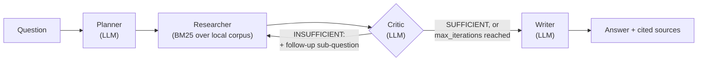

# Multi-Agent Research Assistant

A research assistant built as a **LangGraph** multi-agent graph — not a
single prompt wearing a multi-agent label. A planner breaks a question
into sub-questions, a researcher retrieves evidence for each via BM25 over
a local corpus, a critic decides whether that evidence is actually enough
to answer well and can send the graph back for another research pass if
not, and a writer synthesizes a cited final answer. The critic → researcher
edge is a real cycle in the graph, not a fixed pipeline — see
[Architecture](#architecture).

Runs entirely on a local LLM via **Ollama** — no OpenAI key, no per-query
API cost. Retrieval is **BM25** (lexical, `rank_bm25`), not a dense
embedding model, which is a real design choice explained below, not a
downgrade.

## Why this is worth looking at over a simpler RAG demo

- The multi-agent graph actually branches and loops based on model output,
  not just executed in a fixed order — verified with tests that force the
  critic to reject evidence once and confirm the graph goes back for more
  before writing an answer (`tests/test_graph_end_to_end.py`).
- Every agent node depends on an `LLM` protocol, not a concrete provider —
  the exact same graph code runs against a real Ollama model or a
  deterministic scripted test double, which is what makes the 36-test
  suite runnable in CI with zero API cost and zero flakiness from a real
  model's non-determinism.
- The corpus is 12 original technical documents (not scraped, not
  Lorem Ipsum) written specifically so retrieval has real, checkable
  content — see [What's in the corpus](#whats-in-the-corpus).

## Architecture



| Node | Backed by | What it does |
|---|---|---|
| Planner | LLM | Breaks the question into 2-4 focused sub-questions |
| Researcher | BM25 (`rank_bm25`), no LLM call | Retrieves relevant passages per sub-question from `data/corpus/` |
| Critic | LLM | Judges whether gathered evidence is sufficient; if not, adds one targeted follow-up sub-question and routes back to Researcher |
| Writer | LLM | Synthesizes a cited answer from all gathered evidence |

Bounded by `max_iterations` (default 2, max 5) so a critic that never
approves can't loop forever — see
`tests/test_graph_end_to_end.py::test_bounded_by_max_iterations_even_if_critic_never_approves`.

## Why BM25, not embeddings

Retrieval-augmented generation doesn't require a dense embedding model —
hybrid sparse+dense is standard practice in real RAG systems (see
`data/corpus/retrieval-augmented-generation.md`, which this project's own
corpus documents), and BM25 alone is a legitimate, still-common retrieval
method on its own. It was the right default here for a concrete reason
beyond convenience: it needs no pretrained weights and no network access
to build or query, so it behaves identically in CI, in this repo's own
sandboxed build environment, and on a machine with no internet at all.
Swapping in a dense retriever (`sentence-transformers` + FAISS, say) means
adding a second `Retriever` implementation beside `BM25Retriever`, not
replacing it — see [Future improvements](#future-improvements).

## Setup

```bash
pip install -e ".[dev,websearch]"

# Pull a local model via Ollama (https://ollama.com/download):
ollama pull llama3.2       # ~2GB; qwen2.5:1.5b or phi3:mini work too, smaller
ollama serve                # if not already running

uvicorn research_assistant.api.app:app --reload
```

```bash
curl -X POST http://localhost:8000/research \
  -H "Content-Type: application/json" \
  -d '{"question": "How does quantization affect LLM inference speed, and why?"}'
```

```json
{
  "question": "How does quantization affect LLM inference speed, and why?",
  "sub_questions": ["...", "..."],
  "answer": "... a real, cited answer from your local model ...",
  "sources": [{"doc_id": "model-quantization", "heading": "Where the speedup actually comes from"}],
  "iterations": 1
}
```

### Docker

```bash
docker compose up --build
docker compose exec ollama ollama pull llama3.2   # once — not pulled automatically
curl -X POST http://localhost:8000/research -H "Content-Type: application/json" -d '{"question": "..."}'
```

### Tests (no Ollama, no network needed)

```bash
pip install -e ".[dev]"
ruff check .
pytest -v
```

## What was and wasn't run in this repo's own build environment

Built in a sandbox whose network policy allows GitHub, PyPI, and a handful
of other developer-toolchain hosts, and blocks everything else — including,
tested directly rather than assumed: `huggingface.co`, `ollama.com`,
`registry.ollama.ai` (Ollama's own model registry), `gpt4all.io`, and
every search-engine API tried (DuckDuckGo, Wikipedia). That means:

- **Genuinely run and verified here:** the full 36-test suite (`pytest -v`,
  all passing), `ruff check .` (clean), the BM25 retriever against the
  real corpus with real queries, the full LangGraph multi-agent graph end
  to end including the critic's loop-back edge (with a scripted
  `FakeLLM`, not a real model — see below), the FastAPI app end to end via
  `TestClient`, and the Docker image + `docker compose up` bringing up
  both the app and an Ollama sidecar container with real verified
  container-to-container networking (`app` → `ollama:11434` over the
  compose network, confirmed with a real request, not assumed from the
  compose file alone).
- **Not run here, and don't take on faith:** an actual `ollama pull` and a
  real model generating real text. The Ollama *binary* was downloaded,
  installed, and run for real in this environment (its own release
  artifacts are on GitHub, which is reachable) — pulling model *weights*
  failed with `403 Forbidden` against `registry.ollama.ai`, confirming the
  block rather than assuming it. `research_assistant/llm/ollama_provider.py`
  is a straightforward, standard use of the `ollama` Python client's
  documented API, not exercised end-to-end against a real model from this
  environment. The same applies to `research_assistant/tools/web_search.py`.

This is exactly why every agent node takes an `LLM` protocol
(`research_assistant/llm/base.py`) instead of importing Ollama directly:
`FakeLLM` (`research_assistant/llm/fake_provider.py`) is a scripted,
clearly-labeled test double — matching a `ROLE: <name>` marker in each
node's prompt and returning canned, sometimes sequenced responses — that
lets the graph's actual orchestration logic (routing, state accumulation,
the critic's loop) be verified with real assertions, without pretending a
test double is a language model. On your own machine, with
`ollama pull llama3.2` run once, `OllamaLLM` is a real, live model behind
the identical interface — no code in `research_assistant/graph/` changes.

## What's in the corpus

12 original markdown documents (`data/corpus/`) on AI/ML systems topics —
transformers, RAG, vector databases, multi-agent systems, quantization,
MLOps, federated learning, RLHF, distributed training, prompt engineering,
embedding models, and LLM evaluation — written for this project, not
scraped or generated as filler. They exist so retrieval has real,
inspectable, checkable content: ask the assistant about FedAvg and it
should genuinely find and cite `federated-learning.md`, not something
unrelated. Split into ~5 passages per document by markdown `##` section
(60 total passages) for retrieval.

## Future improvements

- **OpenTelemetry tracing across graph nodes** — right now the only trace
  of what happened during a run is the returned state; a real trace per
  node (with the prompt, response, and latency) would make debugging a
  bad answer far easier, and is a natural next addition since LangGraph
  nodes are just Python functions.
- **A second, dense `Retriever` implementation** (`sentence-transformers` +
  FAISS) alongside `BM25Retriever`, with a hybrid mode that combines both
  rankings — real quality upside for semantic (non-lexical) queries the
  current BM25-only retriever can miss, which is exactly the tradeoff
  `data/corpus/retrieval-augmented-generation.md` describes.
- **RAGAS/DeepEval-based automated evaluation** of answer faithfulness and
  relevance against a small held-out question set, instead of only
  structural tests of the graph's control flow — the two are
  complementary, not redundant: the current tests prove the graph
  *routes and accumulates state correctly*, not that a real model's
  *answers* are good.
- **Streaming responses** from the writer node over the FastAPI endpoint
  (Server-Sent Events), instead of the current wait-for-the-full-graph
  request/response cycle.

## License

MIT. Portfolio project — not affiliated with Ollama, LangChain, or any
company whose technology is discussed in the example corpus.
